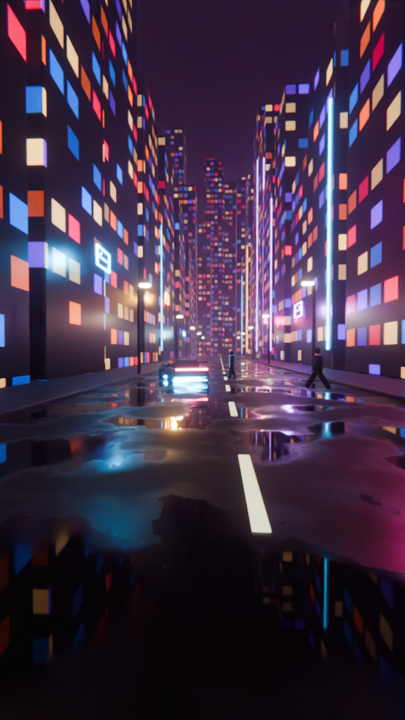

# pipeline — videos verticales 9:16 de 30 a 40 s, modular y open source

Un guion JSON entra; un MP4 H.264 listo para TikTok, Reels y Shorts sale. Cada etapa se ejecuta sola y las caras (render 3D, IA) se saltan si no cambiaron.

```
python -m vidgen doctor                              # qué tienes instalado y qué falta
python -m vidgen todo guion/ejemplo_corto.json       # ejemplo sin dependencias (solo ffmpeg): 6,5 s, 1080×1920, ≈40 s en 4 núcleos
```

## Qué está probado y qué no (léelo primero)

| Pieza | Estado |
|---|---|
| Guion JSON, validación, línea de tiempo | **Probado** (22 pruebas) |
| Efectos FFmpeg: zoom con 4 curvas, pan, shake, glitch, flash, motion blur, bloom, aberración, zoom punch, 4 looks | **Probado con mediciones** (el zoom coincide con la fórmula a ±1 px) |
| Transiciones `xfade` (las 56 que trae este FFmpeg) y cortes | **Probado** |
| Audio: voz por escena, música con ducking, SFX sincronizados, LUFS en dos pasadas | **Probado** (ducking, sincronía y −14 LUFS medidos) |
| Exportación H.264 High / AAC / faststart / bt709 | **Probado** |
| Blender 4.5 LTS headless: calle neón con lluvia, auto, siluetas, cámara, glare | **Probado en CPU** (ver «Blender» abajo); **no probado en GPU** |
| Cliente de ComfyUI y backends `comfy_t2v` / `comfy_i2v` | **Probado contra un servidor simulado**; **nunca ejecutado con ComfyUI ni modelos reales** (no había GPU) |
| Workflows de Wan 2.1 | Derivados de las plantillas oficiales de ComfyUI y comprobados conexión por conexión; **no ejecutados** |
| Textos animados | `drawtext` de FFmpeg (básico). **Remotion como capa de texto: pendiente** (el kit `../video3d` ya tiene las animaciones, falta la composición con fondo transparente) |
| HunyuanVideo, CogVideoX, Open-Sora, AnimateDiff, voz (TTS) | **No integrados** (ver «Otros modelos») |
| Windows y macOS | **No probado**; probado en Linux x86_64 |

Las pruebas: `pruebas/todo.sh` (≈2 min) o `pruebas/todo.sh --rapido` si omites la de punta a punta. Son 112 pruebas; las del propio pipeline se validaron además rompiendo el código a propósito (6 mutaciones, todas detectadas).

## Arquitectura

```
guion.json ──► validar
                 │
   ┌─────────────┴─────────────── etapa «escenas» (un backend por escena) ─────────────┐
   │ lavfi (relleno)   imagen (foto fija)   blender (3D headless)   comfy_t2v / comfy_i2v (IA) │
   └─────────────┬──────────────────────────────────────────────────────────────────────────┘
                 ▼  build/<proyecto>/escenas/<id>.mp4   (huella: solo se rehace lo que cambió)
              efectos   zoom/pan con curva · shake · glitch · flash · motion blur · bloom · aberración
                 ▼  build/.../efectos/<id>.mp4
              textos    texto grande animado (slam · pop · fade)
                 ▼  build/.../textos/<id>.mp4
              unir      xfade / corte + look final (color, LUT .cube, viñeta, grano) → unido.mp4 + linea_tiempo.json
              audio     voz + música (ducking) + SFX + música por escena → loudnorm 2 pasadas → audio.wav
              exportar  H.264 High + AAC → salida/<proyecto>.mp4
```

Una transición pertenece a la escena que sale (es «hacia la siguiente») y solapa ambas: el total es Σ duraciones − Σ transiciones, y el audio usa esa misma línea de tiempo.

### Etapas por separado

```
python -m vidgen validar  guion.json [--estricto]
python -m vidgen escenas  guion.json [--solo e01,e02] [--forzar]
python -m vidgen efectos  guion.json
python -m vidgen textos   guion.json
python -m vidgen unir     guion.json
python -m vidgen audio    guion.json [--stems carpeta]     # voz/música/sfx por separado, para depurar la mezcla
python -m vidgen exportar guion.json --perfil tiktok|reels|shorts|prueba
python -m vidgen todo     guion.json
```

## Estructura de carpetas

```
pipeline/
  README.md  requirements.txt  requirements-opcional.txt
  guion/        guion.schema.json · plantilla.json (7 escenas, ~31 s, todos los campos) · ejemplo_corto.json
  vidgen/       el paquete: cli, guion, etapas, efectos, textos, unir, audio, exportar, doctor, comfy_api, backends/
  blender/      escena_neon.py (se ejecuta DENTRO de Blender)
  comfy/        workflows/*.api.json · verificar_nodos.py
  ffmpeg/       01_exportar_vertical_prueba.sh · recetas.sh
  docs/         prompts.md
  pruebas/      todo.sh · test_*.py · mock_comfy.py
  build/  salida/      (se crean solos; ignorados por git)
```

## Instalación

Obligatorio: Python ≥ 3.10 y FFmpeg con `libx264` y los filtros `xfade`, `sidechaincompress`, `loudnorm`, `rgbashift`, `tmix`, `lutrgb`, `gradients` y `drawtext` (`doctor` los revisa).

```bash
cd pipeline && python3 -m venv .venv && source .venv/bin/activate      # Windows: .venv\Scripts\activate
pip install -r requirements.txt
python -m vidgen doctor
```

| | FFmpeg | Python | Blender 4.5 LTS (opcional) | Node (opcional, kit Remotion) |
|---|---|---|---|---|
| **Linux** (Debian/Ubuntu) | `sudo apt install ffmpeg` | `sudo apt install python3-venv` | tarball de blender.org (abajo) o `sudo snap install blender --classic` | `sudo apt install nodejs npm` |
| **macOS** (Homebrew) | `brew install ffmpeg` | `brew install python@3.11` | `brew install --cask blender` | `brew install node` |
| **Windows** (winget) | `winget install Gyan.FFmpeg` | `winget install Python.Python.3.11` | `winget install BlenderFoundation.Blender` | `winget install OpenJS.NodeJS.LTS` |

Solo el Linux con tarball de Blender se ejecutó aquí; los comandos de macOS, Windows y `snap` son los habituales de cada gestor y **no se probaron**.

```bash
# Blender en Linux sin permisos de administrador (es lo que se probó: 4.5.16, 360 MB)
curl -O https://download.blender.org/release/Blender4.5/blender-4.5.16-linux-x64.tar.xz && tar xf blender-4.5.16-linux-x64.tar.xz
export BLENDER=$PWD/blender-4.5.16-linux-x64/blender          # o ponlo en el PATH
```

**ComfyUI** (para los backends de IA; instálalo donde esté tu GPU, local o en la nube):

```bash
git clone https://github.com/comfyanonymous/ComfyUI && cd ComfyUI
python3 -m venv .venv && source .venv/bin/activate
# PyTorch: usa el selector de https://pytorch.org/get-started/locally/ (CUDA, ROCm, CPU o Apple Silicon)
pip install -r requirements.txt
python main.py --listen            # escucha en http://127.0.0.1:8188; el pipeline lo busca ahí o en COMFY_URL
```

Modelos para el primer workflow (carpetas dentro de `ComfyUI/models/`; los nombres salen de la plantilla oficial de Wan 2.1 de ComfyUI, y la plantilla trae los enlaces de descarga: menú *Workflows → Templates*):

| Archivo | Carpeta | Para |
|---|---|---|
| `wan2.1_t2v_1.3B_fp16.safetensors` | `diffusion_models/` | texto→video (el pequeño) |
| `umt5_xxl_fp8_e4m3fn_scaled.safetensors` | `text_encoders/` | ambos |
| `wan_2.1_vae.safetensors` | `vae/` | ambos |
| `wan2.1_i2v_480p_14B_fp16.safetensors` | `diffusion_models/` | imagen→video (grande, ver requisitos) |
| `clip_vision_h.safetensors` | `clip_vision/` | imagen→video |

Antes de gastar GPU, comprueba que tu servidor tiene los nodos y archivos que piden los workflows: `python comfy/verificar_nodos.py`.

## Requisitos de hardware

| Tarea | Mínimo razonable | Fuente / estado |
|---|---|---|
| Pipeline básico (FFmpeg) | 4 núcleos, 4 GB de RAM, sin GPU | Medido aquí: 4 núcleos y 15 GB |
| Blender, previsualización | CPU sirve, pero lento | **Medido:** 40–70 s por cuadro a 540×960 y 16–32 muestras en 4 núcleos; una escena de 3 s a 24 fps son ~72 cuadros → más de una hora. Para resolución final usa GPU (OPTIX/CUDA/HIP/METAL; `VIDGEN_GPU=1`). **El tiempo en GPU no se midió.** |
| Wan 2.1 texto→video 1.3B | ≈ 8,2 GB de VRAM | [Ficha oficial en Hugging Face](https://huggingface.co/Wan-AI/Wan2.1-T2V-1.3B); 5 s a 480p tardan ≈ 4 min en una RTX 4090 según el [blog de ComfyUI](https://blog.comfy.org/p/wan21-video-model-native-support) |
| Wan 2.1 14B (imagen→video) | **GPU de 40–80 GB** | Las fuentes discrepan (40–48 GB en fp8 a 480p según una tabla; 65–80 GB a 720p según otra): **trátalo como no verificado** y prueba con una GPU de 48–80 GB en la nube |
| Almacenamiento | decenas de GB solo para modelos | **No se verificaron los tamaños exactos**; míralos en la página de descarga de cada archivo |

## Backends de escena

- **`lavfi`**: degradado animado con tu paleta. Sirve para probar y como storyboard.
- **`imagen`**: foto fija + los zooms/pan de la etapa de efectos.
- **`blender`**: `blender -b -P blender/escena_neon.py -- --params params.json` y luego PNG → clip. La escena es procedural y no usa assets ni marcas: ventanas emisivas, asfalto mojado con charcos (rugosidad por ruido), niebla volumétrica, carteles de neón abstractos, auto original con barniz, siluetas animadas con borde de luz, lluvia con partículas, cámara con profundidad de campo (`dolly_in`, `dolly_out`, `orbita`, `grua`, `travelling`, `mano_alzada`, `fija`), glare y dispersión cromática en el compositor. 

  Ajustes por escena en `ajustes.blender`: `samples`, `escala`, `fps_render`, `personajes`, `lluvia`, `niebla`, `gpu`, `interpolar`. Probado con **Blender 4.5 LTS**; la API del compositor cambia en 5.x.
- **`comfy_t2v` / `comfy_i2v`**: Wan 2.1 con workflows en formato API (`comfy/workflows/`). El pipeline busca los nodos por su **título** (`PROMPT_POSITIVO`, `LATENTE`, `SAMPLER`…), no por número. Wan genera a 16 fps y ≤ 81 cuadros (≈ 5 s): el clip se reescala a 1080×1920, se pasa a tus fps y, si es más corto que la escena, `si_corto: "congelar"` repite el último cuadro. Para más fluidez, `minterpolate` de FFmpeg es lo que hay hoy; un interpolador de IA (RIFE) queda pendiente.

### Otros modelos de video

ComfyUI trae plantillas oficiales de **HunyuanVideo**, **LTX-Video** y **Wan 2.2** (`comfyui-workflow-templates` 0.11.112), y se pueden añadir como workflows nuevos: basta un JSON en formato API con los mismos títulos de nodo. **CogVideoX, AnimateDiff y Open-Sora no tienen plantilla oficial ahí**: requieren nodos personalizados de la comunidad que no se evaluaron. Ninguno está integrado todavía.

## Recetas de FFmpeg

Comandos sueltos, sin Python, cada uno probado: `ffmpeg/recetas.sh` (`vertical`, `zoom`, `shake`, `glitch`, `flash`, `motion_blur`, `bloom`, `grade`, `transicion`, `ducking`, `loudnorm`, `exportar`; la cabecera del archivo explica cada argumento). El primer comando, que genera y exporta un video vertical de prueba:

```bash
ffmpeg/01_exportar_vertical_prueba.sh            # → salida/prueba_vertical.mp4 (1080×1920, 5 s, H.264 High + AAC, faststart)
```

## Evitar problemas de copyright (estrategia, no asesoría legal)

- **Personajes y objetos originales**: el 3D es procedural (siluetas sin rostro, auto sin diseño real); en IA, describe rasgos genéricos, nunca nombres de personajes o actores.
- **Sin logos ni marcas dentro de la imagen**: pon `logo, watermark, text, brand` en el prompt negativo; en Blender, los carteles son marcos de neón sin texto.
- **Sin personas reales ni sus voces**: nada de «parecido a…» ni voces clonadas de terceros.
- **No copiar planos concretos** de tráilers ni estilos exactos de un autor: toma el ambiente (noche, neón, lluvia), no la composición.
- **Música**: usa música generada por ti o con licencia. Que un modelo sea open source no garantiza que su salida o sus datos de entrenamiento estén libres de reclamaciones: revisa la licencia de cada modelo.
- **Referencias y nombres propios en texto** (títulos, plataformas) son decisión editorial tuya; el pipeline no los bloquea.

## Costos (instantánea de noviembre de 2026; los precios cambian a diario)

| Proveedor | RTX 4090 por hora | Fuente |
|---|---|---|
| RunPod Community Cloud | ≈ 0,34 USD | [varias comparativas](https://findstack.com/resources/runpod-vs-vast-ai) |
| RunPod Secure Cloud | ≈ 0,69 – 0,89 USD (las fuentes discrepan) | idem |
| Vast.ai (mercado) | mediana ≈ 0,30 – 0,50; mínimos ≈ 0,13; las instancias baratas pueden ser interrumpibles | [comparativa](https://www.spheron.network/blog/runpod-vs-vastai-2026/) |

Estimación propia a partir de dos cifras citadas (≈ 4 min por clip de 5 s con Wan 1.3B en una 4090, y los precios de arriba): **≈ 0,02 – 0,06 USD por clip**, o ≈ 0,15 – 0,45 USD por un video con 7 clips de IA, sin contar el tiempo de descarga de modelos ni el de Blender en GPU (no medido). GPU local: gratis por hora, pero la inversión depende de tu tarjeta. Empieza pequeño: FFmpeg + Blender en CPU para estructura, y alquila GPU solo para los renders de IA y de Blender final.

## Errores comunes (los que aparecieron construyendo esto)

| Síntoma | Causa | Solución |
|---|---|---|
| `Value -inf for parameter 'measured_I'` al normalizar | guion sin audio: la pista es silencio | ya manejado: se exporta pista silenciosa |
| Texto «hueco» (solo se ve el contorno) | fuente TTF variable (p. ej. `BigShouldersDisplay.ttf`): FFmpeg usa su instancia más fina | define `FUENTE=` con una fuente bold estática |
| `Output pad ... not connected` en el audio | etiquetas del grafo sin consumidor | ya manejado con `anullsink` |
| `No hay ComfyUI en http://127.0.0.1:8188` | servidor apagado o en otra dirección | `python main.py --listen`, o `COMFY_URL=http://host:8188` |
| ComfyUI rechaza el workflow (`node_errors`) | nodo o modelo ausente / versión antigua | `python comfy/verificar_nodos.py` te dice cuál |
| Blender: `key "Distort" not found` (Lens Distortion) | en 4.5 el socket se llama `Distortion` | ya corregido en `escena_neon.py` |
| Blender: la «look» de AgX no se aplica | la lista de enum de `look` solo devuelve `NONE` en 4.5 | se asigna directamente (`AgX - High Contrast`) |
| Un render de Blender tarda horas | CPU | `escala` y `samples` bajos para previsualizar; GPU para el final |

## Pendiente (en este orden)

1. Ejecutar de verdad los workflows de Wan en una GPU y ajustar con lo que `verificar_nodos.py` encuentre.
2. Capa de texto con **Remotion** (composición transparente con las animaciones del kit `../video3d`).
3. Tiempo de Blender en GPU y plantilla de más escenas (interior, azotea, mapa).
4. Interpolación de cuadros con IA y los demás modelos de video.
5. Voz en off (reusar `../video3d/herramientas/voz_elevenlabs.py` o una alternativa local).
